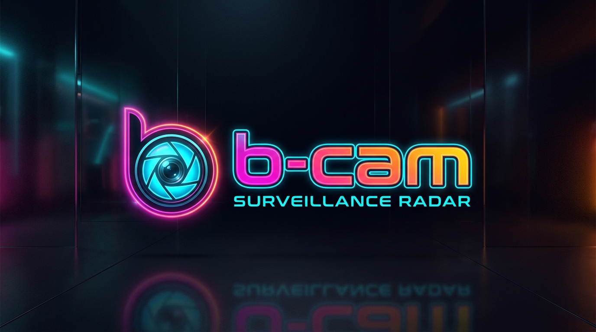
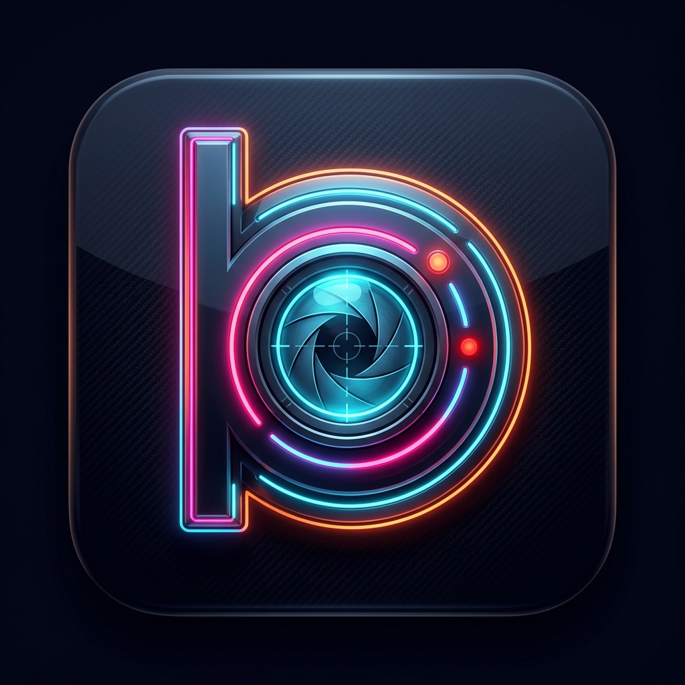
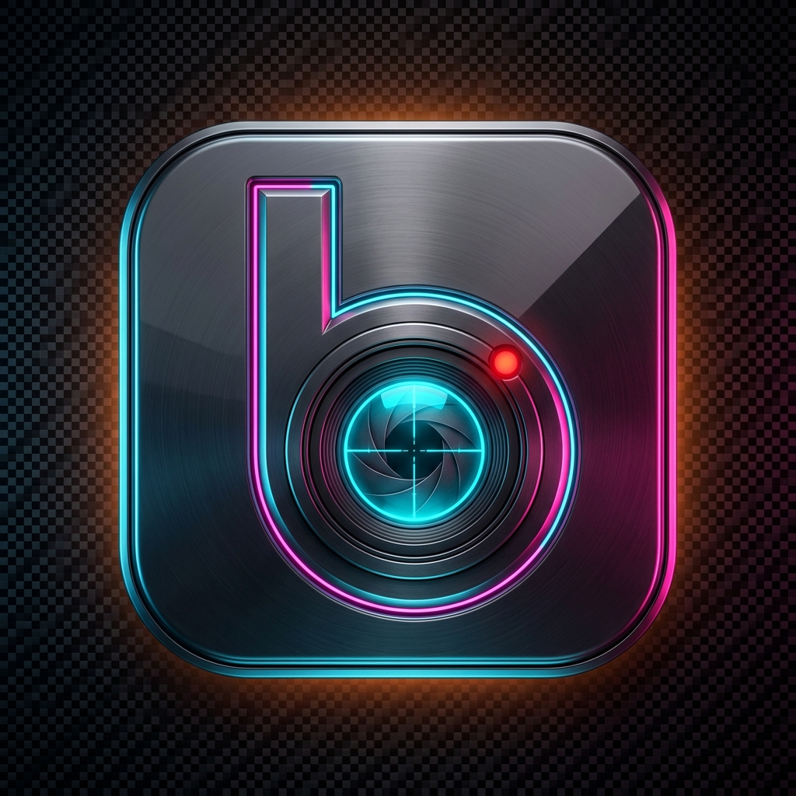

# 🎥 b-cam • Vigilância Inteligente em Redes Wi-Fi

<p align="center">
  
</p>

<p align="center">
  <b>Aplicativo Flutter para varredura IP, comissionamento instantâneo e monitoramento ao vivo de câmeras de vigilância de múltiplos fabricantes em redes Wi-Fi.</b>
</p>

<p align="center">
  
  
  
  
  
</p>

---

## ⚡ Destaques do Projeto

- 📡 **Varredura Wi-Fi Multiestratégia**: Descoberta assíncrona ultra-rápida (sonda ONVIF WS-Discovery + SSDP + varredura concorrente de portas TCP `554, 37777, 8000, 34567, 2020, 9000`).
- 🧠 **Detecção Automática de Fabricante**: Reconhece automaticamente marcas como **Intelbras, Dahua, Hikvision, TP-Link Tapo, Xiongmai/Tuya, Reolink e ONVIF genérico**.
- 🔑 **Comissionamento Zero-Friction**: Montagem automática da URL de stream RTSP e atalhos rápidos para senhas de fábrica padrão (`admin/admin`, `admin/123456`, etc.).
- 🎮 **Identidade Visual Inspirada em GTA VI (Vice City)**: Paleta neon vibrante (`#FF2A85` Neon Pink, `#00F0FF` Electric Cyan, Pôr do Sol Vice City), HUD militar com relógio em tempo real, retículos de mira e radar animado.
- 📺 **Player de Vídeo de Baixa Latência**: Decodificação H.264/H.265 acelerada por hardware via `media_kit` (libmpv).
- 🎛️ **Controle PTZ Virtual & Matriz Multiview**: Painel direcional virtual (Pan/Tilt/Zoom) e grade de visualização simultânea de 1, 4 ou 9 câmeras.

---

## 📸 Telas do Aplicativo

<p align="center">
  
  
</p>

---

## 🧠 Governança e Base de Conhecimento (`context/`)

Todo o histórico do projeto, papéis de equipe e registros de decisão arquitetural (ADRs) estão documentados na pasta [`context/`](./context/):

- 👥 [**TEAM_ROLES.md**](./context/TEAM_ROLES.md): Estrutura da equipe de 5 agentes de IA e matriz RACI.
- 📋 [**PROJECT_CHARTER.md**](./context/PROJECT_CHARTER.md): Visão do produto, metas e especificações técnicas.
- 🔒 [**SECURITY_POLICY.md**](./context/SECURITY_POLICY.md): Políticas de proteção de credenciais e ofuscação de URLs RTSP.
- 🎨 [**UX_DESIGN_SYSTEM.md**](./context/UX_DESIGN_SYSTEM.md): Tokens de design GTA VI, ergonomia e tipografia.
- 🎯 [**QA_TEST_STRATEGY.md**](./context/QA_TEST_STRATEGY.md): Matriz de testes e cenários de resiliência de rede.
- 📂 [**DECISIONS/**](./context/DECISIONS/): Registros formais de Decisão de Arquitetura (ADRs de 001 a 005).
- 📝 [**MEETINGS_AND_LOGS.md**](./context/MEETINGS_AND_LOGS.md): Histórico de reuniões e backlog ativo.

---

## 🚀 Como Executar

### Pré-requisitos
- Flutter SDK 3.41+
- Android SDK 34+ / Emulador Android ou dispositivo conectado
- macOS com Xcode (opcional, para compilar a versão desktop nativa)

### Passos de Instalação
```bash
# 1. Clone o repositório
git clone https://github.com/tbilk27/b-cam.git
cd b-cam

# 2. Obtenha as dependências
flutter pub get

# 3. Execute no emulador ou dispositivo conectado
flutter run -d emulator-5554
```

---

## 👥 Equipe de Múltiplos Agentes

| Papel | Agente | Responsabilidade |
| :--- | :--- | :--- |
| **Líder de Projeto & Orquestrador** | `orchestrator-lead` | Liderança do ciclo de vida, gestão de contexto e comunicação com o usuário |
| **Arquiteto de Software & Segurança** | `software-architect` | Clean architecture, segurança de credenciais, criptografia e ADRs |
| **Desenvolvedor Flutter Especialista** | `flutter-expert` | Streaming RTSP, renderização de vídeo acelerada e widgets customizados |
| **Analista de Qualidade (QA)** | `qa-analyst` | Confiabilidade de conexões, testes de estresse de rede e suites de validação |
| **Especialista em Usabilidade (UX/UI)** | `ux-ui-specialist` | Comissionamento sem atrito, ergonomia e integridade visual GTA VI |
