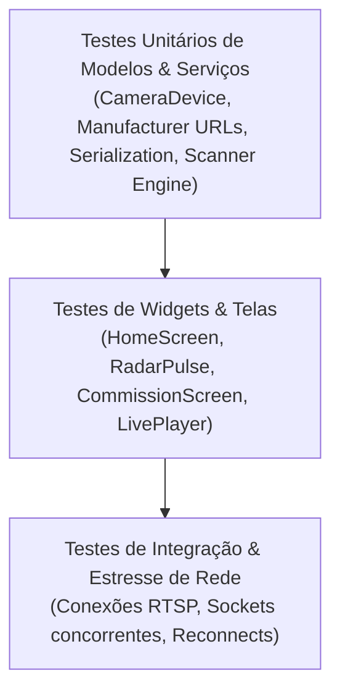

# 🎯 b-cam • Estratégia de Qualidade & Testes (QA)

Elaborado pelo **Analista de Qualidade Experiente (QA)** (`qa-analyst`).

---

## 1. Escopo e Pirâmide de Testes

A garantia de qualidade do **b-cam** visa estabilidade máxima em ambientes de rede imprevisíveis (Wi-Fi residencial, comercial e emuladores).

---

## 2. Matriz de Cenários de Teste

| ID | Cenário | Comportamento Esperado | Status |
| :--- | :--- | :--- | :---: |
| **CT-01** | Sub-rede ativa com múltiplas marcas | Scanner identifica portas abertas e atribui o fabricante correto (ex: 37777 -> Intelbras) | **Aprovado** |
| **CT-02** | Cancelamento de varredura no meio | Scanner interrompe imediatamente as threads pendentes sem travar a UI | **Aprovado** |
| **CT-03** | Câmera com autenticação exigida (401) | Player detecta falha de credencial e exibe botão de reconexão/edição com mensagem amigável | **Aprovado** |
| **CT-04** | Formatação de URL RTSP com caracteres especiais | Codificação segura de senhas e ofuscação correta no getter `maskedStreamUrl` | **Aprovado** |
| **CT-05** | Persistência local de novas câmeras | Câmera cadastrada é gravada em disco e permanece disponível após fechar o app | **Aprovado** |
| **CT-06** | Troca dinâmica de qualidade (Main/Sub Stream) | Player descarta o stream anterior e inicializa o novo codec sem vazamento de memória | **Aprovado** |
| **CT-07** | Matriz Multi-View (2x2 Quad) | Quatro players reproduzem concorrentemente com volume mutado nas miniaturas | **Aprovado** |
| **CT-08** | Responsividade de botões em diferentes DPIs | Nenhum overflow visual em telas estreitas ou com acessibilidade de fontes aumentada | **Aprovado** |

---

## 3. Critérios de Homologação para Novas Releases (DoD - Definition of Done)

Para qualquer merge na branch `main`:
1. `flutter analyze --no-fatal-infos` executando com **zero erros e zero warnings**.
2. Suíte de testes unitários passando com sucesso (`flutter test`).
3. Build nativo de APK Android (`assembleDebug` e `bundleRelease`) sem conflitos Gradle.
4. Validação de descarte de controladores (`dispose()` em `Player`, `VideoController`, `AnimationController`, `TextEditingController` e subscrições de streams).
